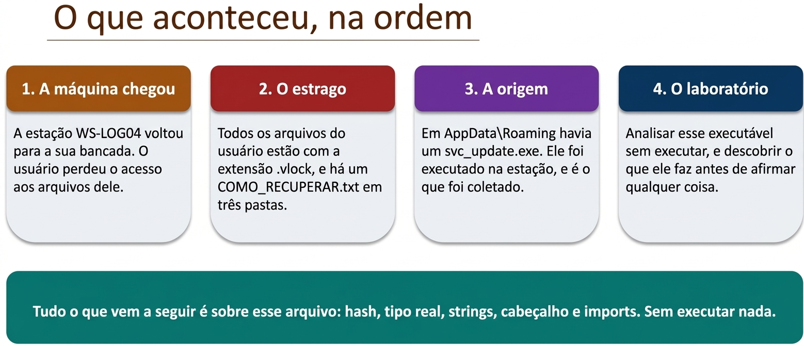
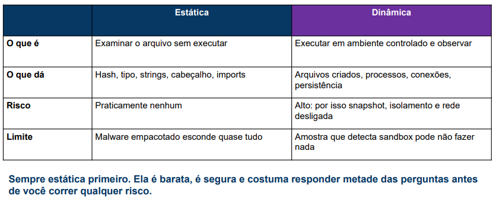
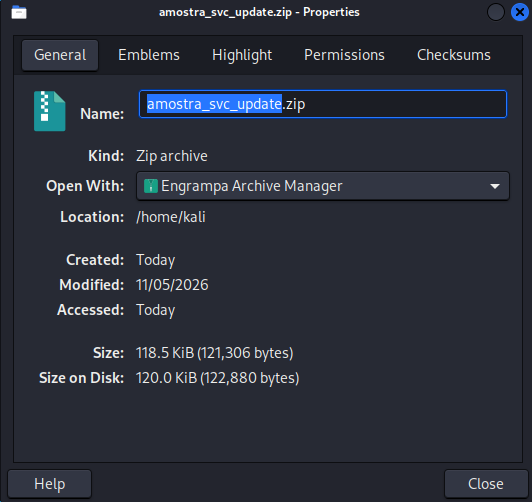
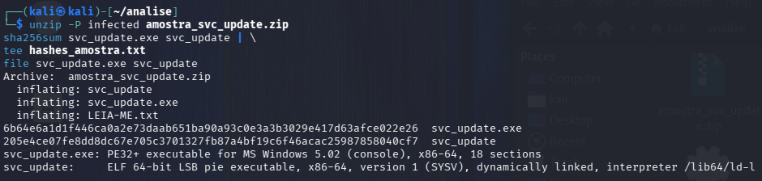
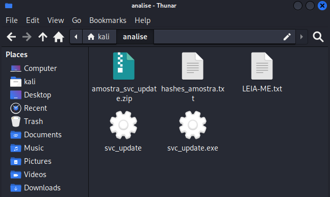
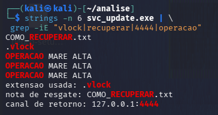
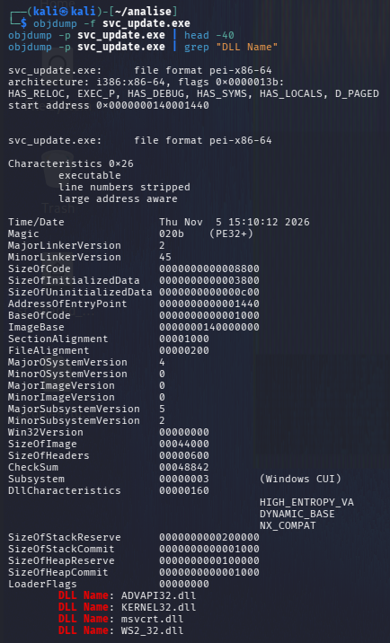
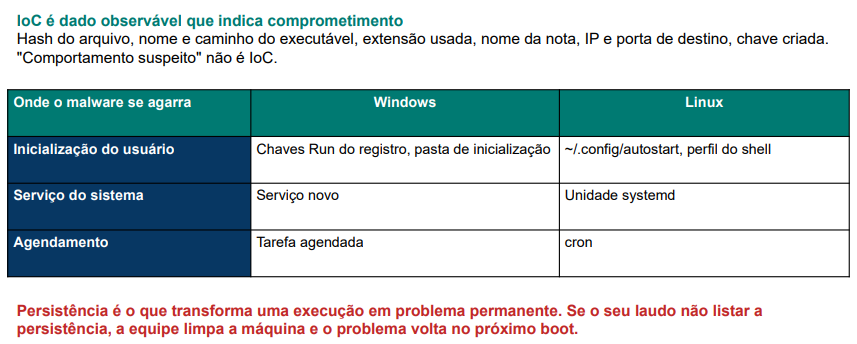

# Análise Estática de Ransomware - `svc_update.exe`


Laboratório de **análise estática** de um executável coletado em uma estação Windows atingida por ransomware. Sem executar a amostra, identifiquei o tipo real do arquivo, calculei os hashes, extraí indicadores de comprometimento (IoCs) pelas strings e levantei as capacidades do binário pelo cabeçalho PE e pelos imports.

> Projeto de portfólio - laboratório de estudos em Segurança da Informação / Análise de Malware.<br>
> **Autor:** Pedro Ataides

> [!WARNING]
> A amostra é um **simulador inerte**, feito para treino: renomeia arquivos, escreve nota de resgate, cria persistência e tenta falar com um servidor de comando, mas não cifra nem apaga nada e não sai da pasta de teste. Mesmo assim, toda a análise foi feita **sem executar o arquivo**. A amostra não é redistribuída neste repositório.

---

## Cenário

<p align="center">
  
</p>

A estação **WS-LOG04** chegou à bancada com o usuário sem acesso aos próprios arquivos: todos estavam com a extensão `.vlock` e havia uma nota `COMO_RECUPERAR.txt` em três pastas. Em `AppData\Roaming` foi encontrado um `svc_update.exe`, que havia sido executado na estação e foi coletado.

**Objetivo:** descobrir o que esse executável faz **antes de afirmar qualquer coisa** - e sem executá-lo.

## Por que começar pela análise estática

<p align="center">
  
</p>

O limite da estática é o malware empacotado (*packed*), que esconde quase tudo - e aí entra a análise dinâmica, em ambiente isolado.

| Técnica | O que entrega |
|---|---|
| Hash (SHA-256) | Identifica a amostra e permite consultar bases públicas sem enviar o arquivo |
| Tipo real (`file`) | Lê o cabeçalho. A extensão pode mentir; o cabeçalho, não |
| Strings | Caminhos, URLs, IPs, portas, mensagens e extensões usadas |
| Cabeçalho PE e imports | Quais funções do Windows o binário pretende usar |

## Ambiente

| Item | Detalhe |
|---|---|
| Sistema | Kali Linux |
| Pasta de trabalho | `~/analise`, separada dos arquivos pessoais |
| Ferramentas | `unzip`, `sha256sum`, `tee`, `file`, `strings`, `grep`, `objdump` |
| Amostra | `amostra_svc_update.zip` - 118,5 KiB (121.306 bytes), protegido com a senha `infected` |

> A senha `infected` é a convenção usada no mundo todo para compartilhar amostras: ela impede que o antivírus leia o conteúdo do ZIP durante o download.

---

## Passo a passo

### 1. Preparar a pasta de análise

<p align="center">
  
</p>

```bash
mkdir -p ~/analise
mv ~/amostra_svc_update.zip ~/analise/
cd ~/analise
```

Uma pasta própria evita analisar a amostra no meio de outros arquivos.

### 2. Extrair, registrar os hashes e identificar o tipo real

```bash
unzip -P infected amostra_svc_update.zip
sha256sum svc_update.exe svc_update | tee hashes_amostra.txt
file svc_update.exe svc_update
```

<p align="center">
  
</p>

<p align="center">
  
</p>

**Hashes** (registrados em `hashes_amostra.txt` logo na extração):

```text
6b64e6a1d1f446ca0a2e73daab651ba90a93c0e3a3b3029e417d63afce022e26  svc_update.exe
205e4ce07fe8dd8dc67e705c3701327fb87a4bf19c6f46acac25987858040cf7  svc_update
```

**Tipo real:**

| Arquivo | Saída do `file` | Leitura |
|---|---|---|
| `svc_update.exe` | PE32+ executable for MS Windows 5.02 (console), x86-64, 18 sections | Executável Windows 64 bits, de console - o arquivo coletado na estação |
| `svc_update` | ELF 64-bit LSB pie executable, x86-64, dynamically linked | Variante Linux da mesma amostra |

O foco desta análise é o `svc_update.exe`.

Amostra fornecida para estudo pelo meu professor de Forense Computacional · [Bruno Rodrigues dos Reis](https://www.linkedin.com/in/brunorodrigues-security/)

### 3. Strings: o que o binário entrega sem ser executado

```bash
strings -n 6 svc_update.exe | grep -iE "vlock|recuperar|4444|operacao"
```

<p align="center">
  
</p>

`-n 6` mostra só sequências com 6 ou mais caracteres, o que reduz o ruído.

| String encontrada | O que indica |
|---|---|
| `.vlock` · `extensao usada: .vlock` | Extensão aplicada aos arquivos - a mesma vista na estação |
| `COMO_RECUPERAR.txt` · `nota de resgate: COMO_RECUPERAR.txt` | Nome da nota de resgate |
| `canal de retorno: 127.0.0.1:4444` | Endereço e porta do servidor de comando e controle (C2) |
| `OPERACAO MARE ALTA` | Marcador da campanha - bom candidato para assinatura |

Na amostra de treino o C2 aponta para *loopback* (`127.0.0.1`), por isso a conexão é recusada; numa amostra real, seria o endereço externo a bloquear. A porta `4444` é a padrão dos *listeners* do Metasploit.

**Sem executar nada, já dá para prever o que a amostra faz - e metade dos IoCs já está em mãos.**

### 4. Cabeçalho PE e imports

```bash
objdump -f svc_update.exe
objdump -p svc_update.exe | head -40
objdump -p svc_update.exe | grep "DLL Name"
```

<p align="center">
  
</p>

Ordem de leitura: primeiro formato e arquitetura, depois as DLLs importadas.

| Campo | Valor | Leitura |
|---|---|---|
| Formato | `pei-x86-64`, Magic `020b` (PE32+) | Executável Windows de 64 bits |
| Subsystem | `3` (Windows CUI) | Aplicação de console |
| Entry point | `0x140001440` (ImageBase `0x140000000`) | Endereço de início da execução |
| Time/Date | `Thu Nov 5 15:10:12 2026` | Data de compilação gravada no cabeçalho (pode ser forjada) |
| Linker | `2.45` | Compatível com o GNU ld (binutils), o que sugere compilação com MinGW-w64 |
| Flags | `HAS_DEBUG`, `HAS_SYMS`, `HAS_LOCALS` | Binário mantém símbolos, o que facilita a análise |
| DllCharacteristics | `HIGH_ENTROPY_VA`, `DYNAMIC_BASE`, `NX_COMPAT` | ASLR e DEP habilitados |

**DLLs importadas:**

| DLL | O que essa DLL oferece | Relação com o comportamento |
|---|---|---|
| `KERNEL32.dll` | Arquivos, diretórios e processos | Varredura de pastas e renomeação dos arquivos |
| `ADVAPI32.dll` | Registro, serviços e CryptoAPI | Criptografia e possível persistência |
| `WS2_32.dll` | Winsock (sockets de rede) | Contato com o C2 em `127.0.0.1:4444` |
| `msvcrt.dll` | Runtime C | Comum em binários compilados com MinGW |

É a **combinação** dos imports - arquivos + criptografia + rede - que sustenta a hipótese de ransomware, e não uma DLL isolada.

---

## Indicadores de comprometimento (IoCs)

IoC é dado observável que indica comprometimento; "comportamento suspeito" não é IoC.

| Tipo | Valor | Origem |
|---|---|---|
| SHA-256 (PE, Windows) | `6b64e6a1d1f446ca0a2e73daab651ba90a93c0e3a3b3029e417d63afce022e26` | `sha256sum` |
| SHA-256 (ELF, Linux) | `205e4ce07fe8dd8dc67e705c3701327fb87a4bf19c6f46acac25987858040cf7` | `sha256sum` |
| Nome e caminho | `C:\Users\<usuário>\AppData\Roaming\svc_update.exe` | Coleta na estação |
| Extensão | `.vlock` | Estação + strings |
| Nota de resgate | `COMO_RECUPERAR.txt` | Estação + strings |
| Rede (C2) | `127.0.0.1:4444` | Strings |
| Marcador | `OPERACAO MARE ALTA` | Strings |

### Checklist de indicadores de ransomware

| Indicador | Status nesta análise |
|---|---|
| Extensão trocada em massa, com sufixo próprio da família | **Confirmado** - `.vlock` na estação e nas strings |
| Nota de resgate repetida em várias pastas | **Confirmado** - `COMO_RECUPERAR.txt` em três pastas e nas strings |
| Processo com uso intenso de disco em curto período | **Pendente** - só observável na análise dinâmica |
| Tentativa de apagar cópias de sombra e backups | **Pendente** - não pesquisado nesta etapa |
| Chamadas de criptografia nos imports | **Indício** - `ADVAPI32.dll` importada; falta confirmar as funções |

## Persistência

<p align="center">
  
</p>

Persistência é o que transforma uma execução em problema permanente: se o laudo não listar a persistência, a máquina é limpa e o problema volta no próximo boot.

A análise estática **não confirma** onde o autorun da amostra é criado. A importação de `ADVAPI32.dll` (registro e serviços) é compatível com chave `Run` do registro ou serviço novo. Pontos a verificar na estação: chaves `Run`, pasta de inicialização, serviços novos e tarefas agendadas.

---

## Conclusão

Sem executar o arquivo, a análise estática mostrou que `svc_update.exe` é um executável Windows de 64 bits, de console, cujas strings revelam a extensão `.vlock`, a nota `COMO_RECUPERAR.txt`, o canal de C2 `127.0.0.1:4444` e o marcador `OPERACAO MARE ALTA` - os mesmos sinais encontrados na WS-LOG04. A combinação de imports (arquivos, criptografia/registro e rede) sustenta a hipótese de ransomware com contato a servidor de comando.

Essa etapa entregou metade dos IoCs com risco praticamente nulo e definiu o que a análise dinâmica precisa confirmar.

## Boas práticas aplicadas

- **Nada executado:** toda a análise foi feita sobre o arquivo em repouso.
- **Isolamento:** amostra analisada numa pasta própria, fora dos arquivos pessoais.
- **Integridade:** hashes registrados em arquivo logo após a extração.
- **Tipo pelo cabeçalho:** identificação com `file`, sem confiar na extensão.
- **IoCs objetivos:** apenas dados observáveis, sem "comportamento suspeito".

## Estrutura do repositório

```
.
├── README.md
├── amostra_svc_update.zip
└── docs/
    ├── 01-cenario-incidente.png
    ├── 02-estatica-vs-dinamica.png
    ├── 03-amostra-properties.png
    ├── 04-hash-e-tipo-real.png
    ├── 05-pasta-analise.png
    ├── 06-strings.png
    ├── 07-cabecalho-pe-imports.png
    └── 08-ioc-e-persistencia.png
```

---

**Aviso:** uso educacional, em ambiente de laboratório.

---

**Pedro Ataides** · [LinkedIn](https://www.linkedin.com/in/pedro-ataides/) · [GitHub](https://github.com/eupedromiguel)
